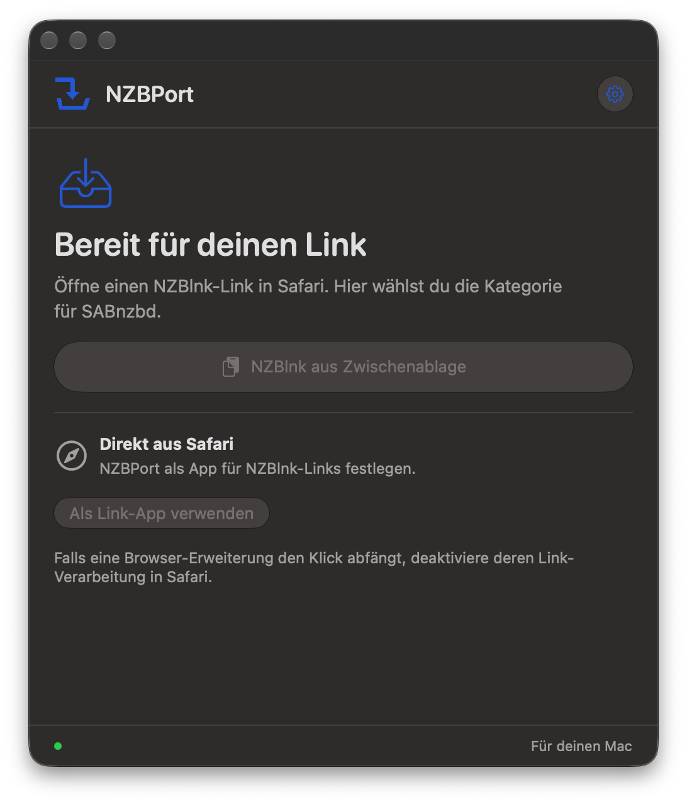
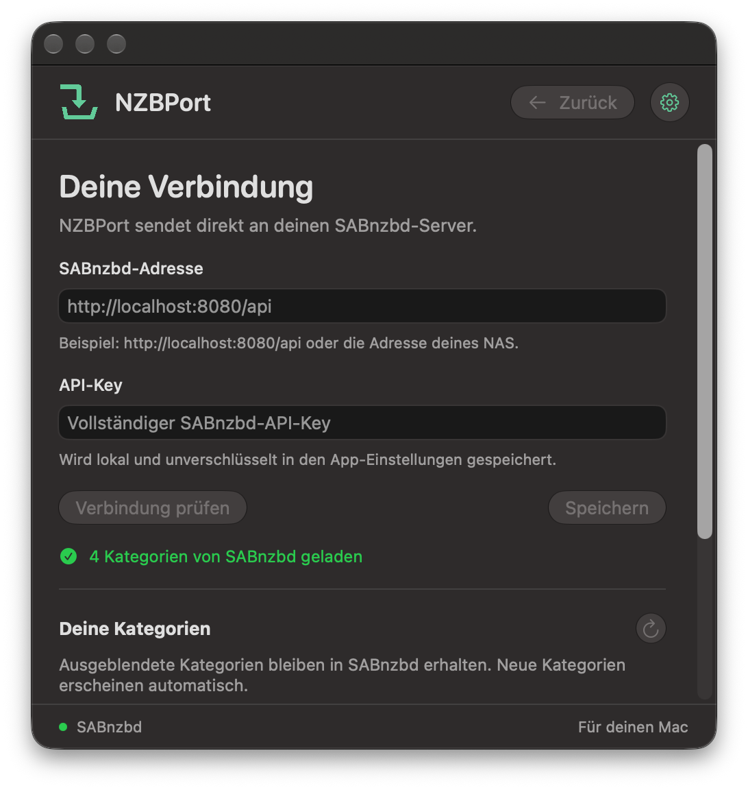

# NZBPort

[English](README.md) · [Downloads](https://github.com/Schrotty74/NZBPort/releases)

> Aktuelle Testversion: **0.2.5**. [DMG oder ZIP herunterladen](https://github.com/Schrotty74/NZBPort/releases/tag/v0.2.5).

NZBPort ist eine kleine macOS-Menüleisten-App, die `nzblnk:`-Links und NZB-Dateien öffnet und Downloads an SABnzbd übergibt. Nach deiner Kategorieauswahl sucht sie bei Bedarf nacheinander über NZBIndex, NZBKing und BinSearch sowie anschließend bei eingerichteten Indexern. NZB-Dateien kannst du auch lokal speichern. Sobald SABnzbd die Übergabe bestätigt, schließt sich das Fenster. Die App bleibt in der Menüleiste erreichbar.

## Funktionen

- **NZBlnk-Links und NZB-Dateien öffnen**: aus Safari, der Zwischenablage, über „Öffnen mit“ im Finder, die Dateiauswahl oder per Drag-and-drop.
- **NZB-Dateien speichern**: lokal und mit dem Link-Passwort unverändert als NZB-Metadatum, falls eines enthalten ist.
- **NZBs suchen** bei bis zu acht Anbietern in dieser Reihenfolge: NZBIndex, NZBKing und BinSearch, danach bei Treasure Maps, NewzBay, NinjaCentral, DrunkenSlug und NZBFinder, sofern für den jeweiligen Dienst ein API-Key gespeichert ist.
- **SABnzbd-Kategorien wählen und verwalten**: Kategorien in SABnzbd anlegen oder löschen. Favoriten und ausgeblendete Kategorien verwaltest du lokal in NZBPort.
- **Priorität festlegen, Aufträge pausiert übergeben und wartende Links und Dateien verwalten**: Einträge vor der Übergabe ansehen und einzeln entfernen.
- **Downloads im Blick behalten**: Fortschritt, Kategorien und Verlauf sehen, einzelne Aufträge oder die ganze Warteschlange pausieren und fortsetzen.
- **SABnzbd-Status im Menü abrufen**: Anzahl der Aufträge und, falls verfügbar, Downloadgeschwindigkeit sehen.
- **macOS-Mitteilungen erhalten**, wenn Downloads abgeschlossen sind oder fehlschlagen.
- **Bei der Anmeldung starten** und NZBPort direkt in der Menüleiste bereithalten.
- **Verbindungseinstellungen** ordnen SABnzbd und optionale Suchdienste in getrennten Gruppen. Die Fensterhöhe passt sich dem Inhalt und dem verfügbaren Bildschirmplatz an. Eine von Hand geänderte Größe gilt bis zum nächsten Öffnen.

[Alle Funktionen im Detail](docs/FEATURES.de.md).

## Bildschirmfotos

| Hauptfenster | Verbindungseinstellungen |
| --- | --- |
|  |  |

Die Screenshots zeigen eine frühere NZBPort-Version. Die private Serveradresse im ersten Screenshot wurde unkenntlich gemacht.

## Voraussetzungen und Installation

- Ein Mac mit Apple Silicon und macOS 26 oder neuer.
- Ein laufender SABnzbd-Server und dessen vollständiger API-Key. API-Keys für Suchdienste sind optional.

Lade die DMG oder ZIP unter [Releases](https://github.com/Schrotty74/NZBPort/releases) herunter. Öffne die DMG und ziehe NZBPort in „Applications“, oder entpacke die ZIP und verschiebe die App nach „Programme“. Die App ist ad hoc signiert und nicht von Apple notarisiert. Falls macOS den ersten Start blockiert, folge den Gatekeeper-Schritten unten.

### Gatekeeper: NZBPort zum ersten Mal öffnen

Erlaube nur einen Build aus den offiziellen [NZBPort-GitHub-Releases](https://github.com/Schrotty74/NZBPort/releases), dem du vertraust.

1. Verschiebe die App nach „Programme“ und versuche einmal, `NZBPort.app` normal zu öffnen, damit macOS den blockierten Start registriert.
2. Öffne **Systemeinstellungen → Datenschutz & Sicherheit** und scrolle zum Bereich **Sicherheit**.
3. Klicke bei NZBPort auf **Dennoch öffnen**.
4. Bestätige mit **Öffnen** und authentifiziere dich, falls macOS dich dazu auffordert.

**Dennoch öffnen** erscheint nur für begrenzte Zeit nach dem blockierten Startversuch. Fehlt die Schaltfläche, versuche erneut, die App zu öffnen, und kehre zu diesen Einstellungen zurück. Dadurch wird eine Ausnahme für NZBPort angelegt; Gatekeeper bleibt systemweit aktiviert.

Siehe auch [Apples Anleitung zum sicheren Öffnen von Apps](https://support.apple.com/de-de/102445).

## Einrichten

1. Öffne NZBPort und trage die SABnzbd-Adresse und den vollständigen API-Key ein.
2. Prüfe die Verbindung und speichere die Einstellungen.
3. Wähle „Als Link-App verwenden“, um NZBPort für `nzblnk:`-Links zu registrieren.
4. Falls ein Browser-Userscript die Links bereits abfängt, deaktiviere es auf diesem Mac.

## Datenschutz und Suchdienste

SABnzbd-Adresse und API-Key werden lokal und unverschlüsselt in den App-Einstellungen gespeichert. Die App verwendet keinen Schlüsselbund. Der API-Key wird im POST-Inhalt an den eingestellten SABnzbd-Endpunkt gesendet. HTTP wird unterstützt; nutze für fremde Netze HTTPS oder ein vertrauenswürdiges VPN.

NZBIndex, NZBKing und BinSearch erhalten die Suchkennung des Links. NZBIndex erhält zusätzlich die Newsgroups. Wenn diese Dienste nichts finden, sucht NZBPort bei eingerichteten Anbietern in dieser Reihenfolge: Treasure Maps, NewzBay, NinjaCentral, DrunkenSlug und NZBFinder. Jeder Anbieter erhält den Releasetitel und nur seinen eigenen API-Key. Die Anbieter-Keys sind optional und werden erst nach dem Speichern lokal und unverschlüsselt abgelegt. Um einen Dienst abzuschalten, leere sein Feld und speichere die Einstellungen. Ein direkter angemeldeter Test bei NinjaCentral lieferte einen passenden Treffer und eine gültige NZB-Datei. Ein angemeldeter NewzBay-Test endete mit HTTP 429; ein Live-Download ist daher nicht bestätigt. Die öffentlichen Capabilities von DrunkenSlug bestätigten die Titelsuche, eine angemeldete Live-Suche wurde jedoch nicht bestätigt. Für API-Zugriff auf NZBFinder ist eine Premium-Mitgliedschaft erforderlich; ein kostenloses Konto kann HTTP 401 mit API-Fehler 102 liefern.

NZBPort lädt Treffer eingerichteter Indexer selbst und übergibt die NZB-Datei an SABnzbd. SABnzbd erhält außerdem den Titel, die gewählte Kategorie und das optionale Archivpasswort. Beim Speichern einer NZB-Datei trägt NZBPort das Link-Passwort unverändert als NZB-Metadatum ein. Den SABnzbd-Key erhält nur der von dir eingestellte SABnzbd-Server. Die Suche hängt von der Verfügbarkeit und den Bedingungen der Anbieter ab. Die HTML-Ausweichsuche kann ausfallen, wenn ein Anbieter seine Seiten ändert oder automatisierte Zugriffe sperrt. Zugangssperren und CAPTCHAs werden nicht umgangen.

Das Speichern einer NZB-Datei ist auch möglich, wenn SABnzbd nicht eingerichtet oder nicht erreichbar ist. Importierte NZB-Dateien kannst du als Kopie speichern. Der aktuelle Link oder die Datei bleibt erhalten, wenn du den Speicherdialog abbrichst oder das Speichern fehlschlägt. Du kannst es erneut versuchen oder eine andere Aktion wählen.

Der Anwendungscode wurde für dieses Projekt in Swift neu geschrieben: Link-Auswertung, Suchdienste, HTML-Parser, SABnzbd-Client und lokaler Kategorienfilter. Die App enthält keinen fremden Anwendungscode und keine externen Paketabhängigkeiten. Sie verwendet Apples Swift-Standardbibliothek und Systemframeworks wie Foundation, AppKit und SwiftUI. Auch das Markenzeichen wurde für dieses Projekt erstellt.

## Bauen

Benötigt wird Xcode mit macOS-26-SDK oder neuer, einschließlich der Icon-Composer-Asset-Kompilierung. Wähle es mit `xcode-select` aus. Externe Pakete sind nicht erforderlich.

```sh
swift test
zsh Scripts/build.sh
```

Die App entsteht unter `Build/NZBPort.app` und wird lokal ad hoc signiert. Das Build-Skript leitet den Projektordner aus seinem eigenen Speicherort ab und entfernt Debugsymbole aus der verteilten Programmdatei. Es installiert keine Zertifikate und veröffentlicht nichts.

| Bereich | Aufgabe |
| --- | --- |
| `Sources/RelayCore` | Link-Auswertung, Suchdienste, SABnzbd-API und Kategorienfilter |
| `Sources/NZBRelay` | App-Lebenszyklus, Menüleiste und Zustand |
| `Sources/NZBRelay/UI` | Ansichten und Einstellungen |
| `Sources/NZBRelay/Localization` | Gespeicherte Sprachwahl und natives Sprachmenü |
| `Sources/RelayCore/Resources` | Deutsche und englische Texte für Oberfläche und Fehler |
| `Sources/NZBRelay/Theme` | Erscheinungsbild und native Glass-Bedienelemente |
| `Resources/NZBPort.icon` | Bearbeitbares Icon-Composer-Dokument |
| `Scripts` | App-Build und Erzeugung des eigenen Markenzeichens |
| `Tests` | Tests für Parser, Suchauflösung und API-Verträge |

Die internen Targets heißen weiterhin `NZBRelay`; der sichtbare App-Name lautet NZBPort. Die Einstellungen sind der Bundle-ID der App zugeordnet.

## Lizenz

GNU General Public License Version 3. Siehe [LICENSE](LICENSE).
