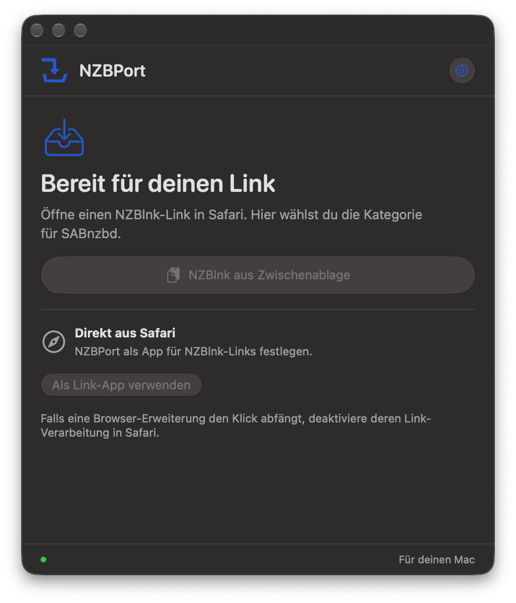
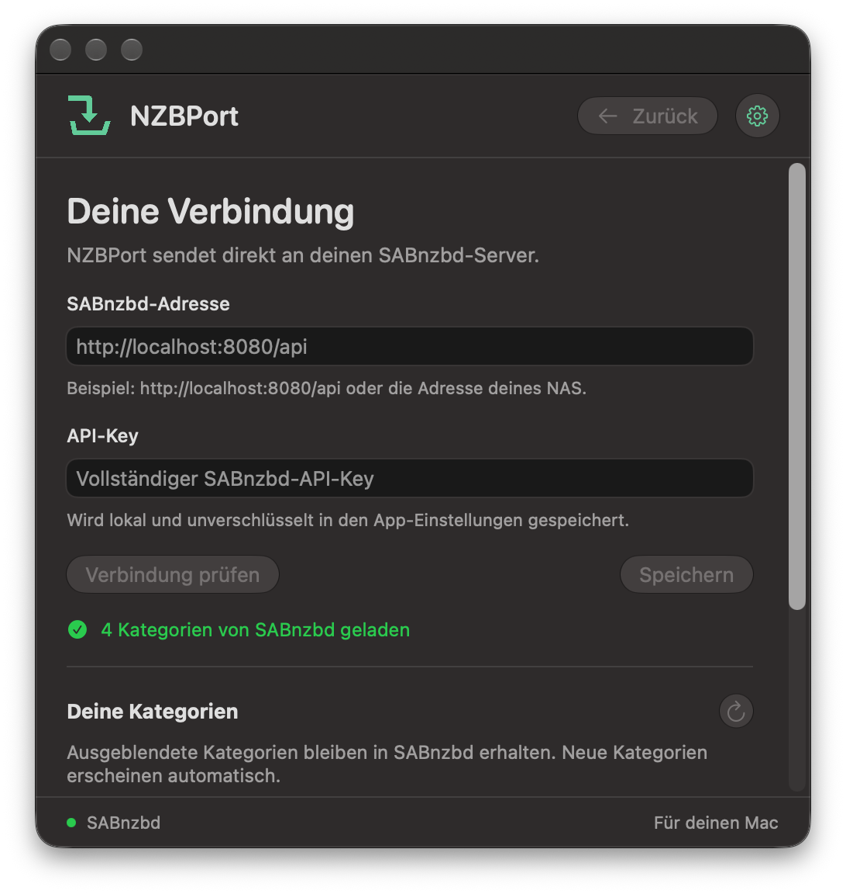

# NZBPort

[English](README.md) · [Downloads](https://github.com/Schrotty74/NZBPort/releases)

> Aktuelle Testversion: **0.2**. [DMG oder ZIP herunterladen](https://github.com/Schrotty74/NZBPort/releases/tag/v0.2).

NZBPort ist eine kleine macOS-Menüleisten-App, die `nzblnk:`-Links öffnet und Downloads an SABnzbd übergibt. Nach deiner Kategorieauswahl sucht sie bei Bedarf nacheinander über NZBIndex, NZBKing und BinSearch. Sobald SABnzbd die Übergabe bestätigt, schließt sich das Fenster. Die App bleibt in der Menüleiste erreichbar.

## Funktionen

- `nzblnk:`-Links direkt aus Safari öffnen oder aus der Zwischenablage einfügen.
- Vor der Übergabe eine SABnzbd-Kategorie auswählen.
- Über NZBIndex suchen, mit NZBKing und BinSearch als Ausweichdiensten.
- Link-Titel und optionales Entpackpasswort an SABnzbd übergeben.
- Kategorien beim App-Start, beim Öffnen eines Links oder manuell in den Einstellungen aktualisieren.
- Kategorien lokal ausblenden und wieder einblenden, ohne sie in SABnzbd zu ändern; neue Kategorien erscheinen automatisch.
- Verbindungsfehler und fehlgeschlagene Übergaben in der App anzeigen.
- Mehrere Links nacheinander bearbeiten und nach der Übergabe in der Menüleiste bleiben.
- Sofort zwischen **English**, **Deutsch** und **System** umschalten; standardmäßig den unterstützten macOS-Spracheinstellungen folgen.
- **Standard**, **Coffee**, **Elfenbein** oder **Minze** wählen, unabhängig von Hell/Dunkel und Fenstertransparenz.
- Native Liquid-Glass-Bedienelemente und ein anpassungsfähiges Icon-Composer-App-Icon nutzen.
- **Beim Anmelden starten** über die macOS-Anmeldeobjekte ein- oder ausschalten.
- GitHub-Projekt und Portfolio-Homepage über **Über NZBPort** öffnen.
- Eigenen Swift-Anwendungscode mit Apple-Systemframeworks und ohne externe Paketabhängigkeiten selbst bauen.

- `.nzb`-Dateien über Dateiauswahl, „Öffnen mit“ und Drag-and-drop öffnen (16 MiB pro Datei; insgesamt 64 MiB wartende Daten).
- Downloadpriorität wählen oder Aufträge pausiert übergeben.
- Favoriten markieren und anordnen; Kategorienbereich in den Verbindungseinstellungen auf- und zuklappen.
- Fortschritt, Geschwindigkeit, Restgröße, Restzeit und letzte Aufträge in der Downloadübersicht anzeigen.
- Einzelne Aufträge oder die gesamte SABnzbd-Warteschlange pausieren und fortsetzen.
- Status mit zwei Sekunden Wartezeit zwischen Abrufen aktualisieren, solange die Übersicht sichtbar oder Benachrichtigungen aktiv sind.
- Optionale macOS-Abschluss- und Fehlermeldungen einschalten. Bereits vorhandener Verlauf wird beim ersten Abruf übersprungen; Entpacken zählt noch nicht als Abschluss.
- Wiederholte Übergabeversuche innerhalb von zehn Minuten bestätigen, auch nach unklaren Verbindungsfehlern; dafür liegen nur Hashes und Zeitstempel im Arbeitsspeicher.
- SABnzbd ohne API-Key in der Browseradresse öffnen.
- GitHub-Updates manuell prüfen, auf Wunsch einschließlich Testversionen; kein automatischer Download oder Installer.

## Bildschirmfotos

| Hauptfenster | Verbindungseinstellungen |
| --- | --- |
|  |  |

Die private Serveradresse im ersten Screenshot wurde unkenntlich gemacht.

## Voraussetzungen und Installation

- Ein Mac mit Apple Silicon und macOS 26 oder neuer.
- Ein laufender SABnzbd-Server und dessen vollständiger API-Key.

Lade die DMG oder ZIP unter [Releases](https://github.com/Schrotty74/NZBPort/releases) herunter. Öffne die DMG und ziehe NZBPort in „Applications“, oder entpacke die ZIP und verschiebe die App nach „Programme“. Die App ist ad hoc signiert und nicht von Apple notarisiert. Falls macOS den ersten Start blockiert, folge den Gatekeeper-Schritten unten.

### Gatekeeper: NZBPort zum ersten Mal öffnen

Erlaube nur einen Build aus den offiziellen [NZBPort-GitHub-Releases](https://github.com/Schrotty74/NZBPort/releases), dem du vertraust.

1. Verschiebe die App nach „Programme“ und versuche einmal, `NZBPort.app` normal zu öffnen, damit macOS den blockierten Start registriert.
2. Öffne **Systemeinstellungen → Datenschutz & Sicherheit** und scrolle zum Bereich **Sicherheit**.
3. Klicke bei NZBPort auf **Dennoch öffnen**.
4. Bestätige mit **Öffnen** und authentifiziere dich, falls macOS dich dazu auffordert.

**Dennoch öffnen** erscheint nur für begrenzte Zeit nach dem blockierten Startversuch. Fehlt die Schaltfläche, versuche erneut, die App zu öffnen, und kehre zu diesen Einstellungen zurück. Dadurch wird eine Ausnahme für NZBPort angelegt; Gatekeeper bleibt systemweit aktiviert.

Siehe auch [Apples Anleitung zum sicheren Öffnen von Apps](https://support.apple.com/de-de/102445).

## Einrichten

1. Öffne NZBPort und trage die SABnzbd-Adresse und den vollständigen API-Key ein.
2. Prüfe die Verbindung und speichere die Einstellungen.
3. Wähle „Als Link-App verwenden“, um NZBPort für `nzblnk:`-Links zu registrieren.
4. Falls ein Browser-Userscript die Links bereits abfängt, deaktiviere es auf diesem Mac.

Die Oberfläche unterstützt Deutsch und Englisch. Im App-Menü, im Menüleistensymbol und im Zahnradmenü wählst du unter **Sprache** zwischen **System, Deutsch und English**. Standardmäßig verwendet die App die erste unterstützte Sprache aus deinen macOS-Einstellungen. Ist keine dabei, verwendet sie Englisch. Eine manuelle Auswahl wird lokal gespeichert und gilt sofort, auch für Menüs und app-eigene Fehlermeldungen. Kopierte Links kannst du über „NZBlnk aus Zwischenablage“ öffnen. Beim App-Start und beim Öffnen eines Links werden die Kategorien von SABnzbd neu geladen. Die Startabfrage läuft im Hintergrund; schlägt sie fehl, zeigt die App eine Fehlermeldung. Der Aktualisieren-Button neben **Deine Kategorien** in den Verbindungseinstellungen lädt sie auch manuell neu. In den Einstellungen kannst du Kategorien ausblenden und wieder einblenden. Das betrifft nur die Anzeige in NZBPort; SABnzbd bleibt unverändert. Neue Kategorien erscheinen automatisch. Mehrere Links werden nacheinander bearbeitet.

Im App-Menü und im Zahnradmenü wählst du zwischen den Farbthemen **Standard, Coffee, Elfenbein und Minze**. Davon unabhängig lassen sich System, Hell und Dunkel sowie ein systemgesteuerter, transparenter oder deckender Fensterhintergrund wählen. Die Farbthemen passen sich dem hellen und dunklen Modus an; die Auswahl wird lokal gespeichert. Die Bedienelemente nutzen natives Liquid Glass. Das Icon-Composer-Dokument unterstützt die Systemdarstellungen des App-Icons.

Unter **Autostart → Beim Anmelden starten** im App-Menü, im Menüleistensymbol oder im Zahnradmenü schaltest du den Start bei der macOS-Anmeldung ein oder aus. Die Einstellung wird erst durch deine Auswahl geändert. Verlangt macOS eine Freigabe, führt **In macOS erlauben …** zu den Anmeldeobjekten in den Systemeinstellungen.

**Über NZBPort** führt zum GitHub-Projekt und zur [Portfolio-Homepage](https://schrotty74.github.io/Portfolio/). Die Links öffnen sich erst nach deiner Auswahl im Standardbrowser.

## Vom Link zum Download

1. Der Browser übergibt einen `nzblnk:`-Link an die registrierte macOS-App. Zuvor kann der Browser eine Bestätigung verlangen.
2. NZBPort liest Suchkennung (`h`), Titel (`t`), optionales Passwort (`p`) und wiederholte Gruppenfelder (`g`). Prozentkodierter Text wird unterstützt; abgekürzte `a.b.`-Gruppen werden für NZBIndex ausgeschrieben.
3. Die App ruft die aktuellen SABnzbd-Kategorien ab und berücksichtigt deine lokal ausgeblendeten Kategorien. Über das Suchfeld kannst du die Kategoriebuttons nach Namen filtern.
4. Mit der Kategorieauswahl beginnt die Suche. Zuerst wird die öffentliche JSON-API von NZBIndex ohne zusätzlichen Such-API-Key verwendet. Schlägt die Suche fehl, folgen NZBKing und BinSearch mit ihren öffentlichen Suchantworten.
5. NZBPort übergibt Downloadadresse, Titel, gewählte Kategorie und optionales Archivpasswort an SABnzbd. Den Download übernimmt SABnzbd; NZBPort lädt selbst keine Usenet-Artikel.
6. Nach einer bestätigten Übergabe schließt sich das Fenster oder der nächste wartende Link erscheint. Bei einem Fehler bleibt die Meldung sichtbar. Läuft eine Übergabe in ein Timeout, prüfe vor einem neuen Versuch die SABnzbd-Warteschlange, um doppelte Aufträge zu vermeiden.

Mehrere unterschiedliche Trefferkennungen lehnt der NZBIndex-Provider ab; anschließend geht die Ausweichsuche weiter. Die HTML-Provider verwenden den ersten unterstützten Treffer ihrer Antwort. Suchtreffer garantieren weder Inhalt noch Verfügbarkeit. Die App legt keine SABnzbd-Kategorien an, löscht keine Kategorien und verwaltet keine Usenet-Zugänge.

## Datenschutz und Suchdienste

SABnzbd-Adresse und API-Key werden lokal und unverschlüsselt in den App-Einstellungen gespeichert. Die App verwendet keinen Schlüsselbund. Der API-Key wird im POST-Inhalt an den eingestellten SABnzbd-Endpunkt gesendet. HTTP wird unterstützt; nutze für fremde Netze HTTPS oder ein vertrauenswürdiges VPN.

Die Suchdienste erhalten die Suchkennung des Links; NZBIndex erhält zusätzlich dessen Gruppen. Titel, Archivpasswort und SABnzbd-Key gehören nicht zu den Suchanfragen. Titel und optionales Passwort werden zusammen mit der gewählten Kategorie an SABnzbd übergeben. Verfügbarkeit und Nutzung hängen von den externen Diensten und deren Bedingungen ab. Die HTML-Ausweichsuche kann bei Seitenänderungen oder einer Sperre automatisierter Zugriffe ausfallen. Zugangssperren und CAPTCHAs werden nicht umgangen.

Der Anwendungscode wurde für dieses Projekt in Swift neu geschrieben: Link-Auswertung, Suchdienste, HTML-Parser, SABnzbd-Client und lokaler Kategorienfilter. Die App enthält keinen fremden Anwendungscode und keine externen Paketabhängigkeiten. Sie verwendet Apples Swift-Standardbibliothek und Systemframeworks wie Foundation, AppKit und SwiftUI. Auch das Markenzeichen wurde für dieses Projekt erstellt.

## Bauen

Benötigt wird Xcode mit macOS-26-SDK oder neuer, einschließlich der Icon-Composer-Asset-Kompilierung. Wähle es mit `xcode-select` aus. Externe Pakete sind nicht erforderlich.

```sh
swift test
zsh Scripts/build.sh
```

Die App entsteht unter `Build/NZBPort.app` und wird lokal ad hoc signiert. Das Build-Skript leitet den Projektordner aus seinem eigenen Speicherort ab und entfernt Debugsymbole aus der verteilten Programmdatei. Es installiert keine Zertifikate und veröffentlicht nichts.

| Bereich | Aufgabe |
| --- | --- |
| `Sources/RelayCore` | Link-Auswertung, Suchdienste, SABnzbd-API und Kategorienfilter |
| `Sources/NZBRelay` | App-Lebenszyklus, Menüleiste und Zustand |
| `Sources/NZBRelay/UI` | Ansichten und Einstellungen |
| `Sources/NZBRelay/Localization` | Gespeicherte Sprachwahl und natives Sprachmenü |
| `Sources/RelayCore/Resources` | Deutsche und englische Texte für Oberfläche und Fehler |
| `Sources/NZBRelay/Theme` | Erscheinungsbild und native Glass-Bedienelemente |
| `Resources/NZBPort.icon` | Bearbeitbares Icon-Composer-Dokument |
| `Scripts` | App-Build und Erzeugung des eigenen Markenzeichens |
| `Tests` | Tests für Parser, Suchauflösung und API-Verträge |

Die internen Targets heißen weiterhin `NZBRelay`; der sichtbare App-Name lautet NZBPort. Die Einstellungen sind der Bundle-ID der App zugeordnet.

## Lizenz

GNU General Public License Version 3. Siehe [LICENSE](LICENSE).
