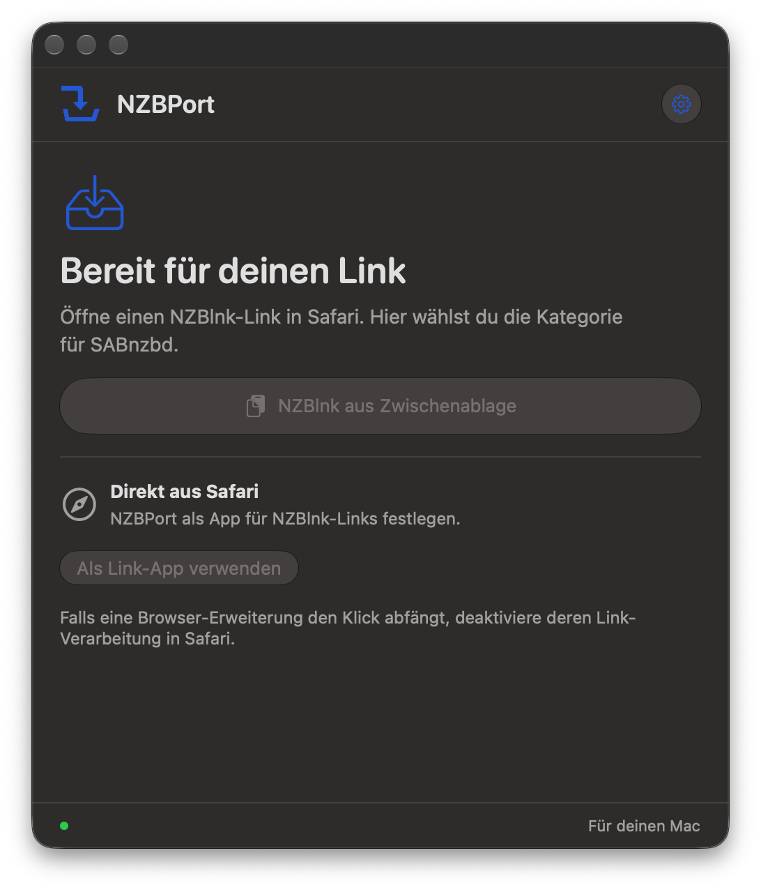
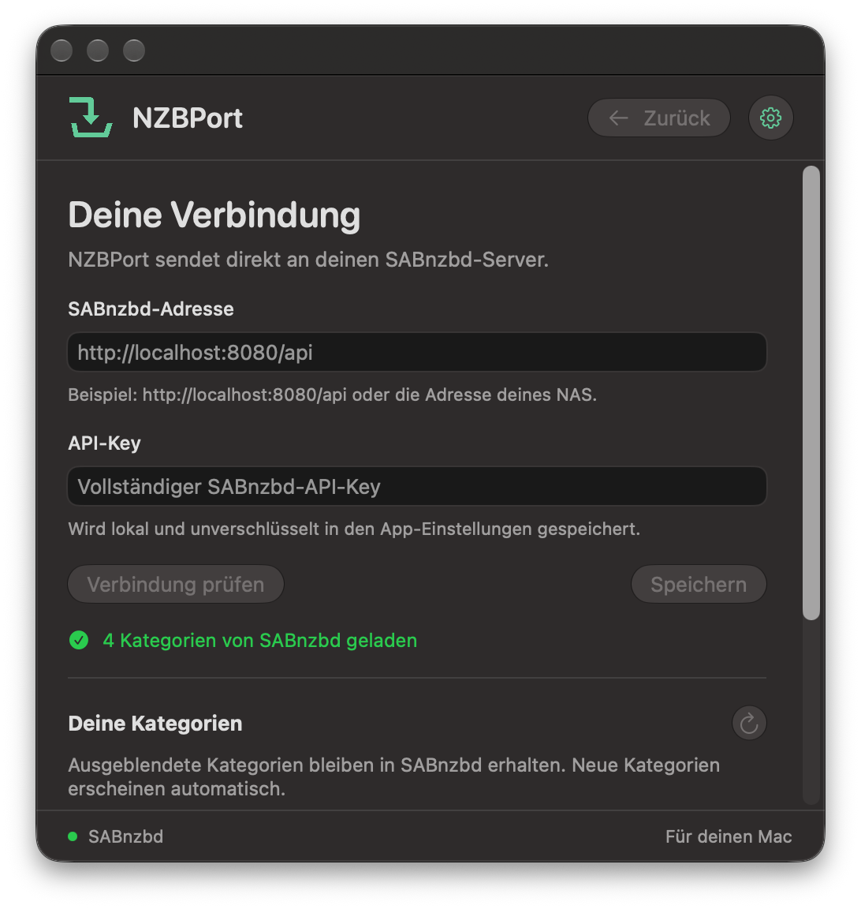

# NZBPort

[Deutsch](README.de.md) · [Downloads](https://github.com/Schrotty74/NZBPort/releases)

> Current test version: **0.2.9**. [Download DMG or ZIP](https://github.com/Schrotty74/NZBPort/releases/tag/v0.2.9).

The separate [iOS userscript](Userscripts/NZBPort.user.js) has its own [documentation](Userscripts/README.md).

NZBPort is a macOS menu bar app that opens `nzblnk:` links and NZB files and sends jobs to SABnzbd. Choose a category yourself or let NZBPort assign one from the release title. You can also save NZB files locally.

## Features

- **Open NZBlnk links and NZB files**. Save NZBs locally with the original link password when included.
- **Watch a download folder**. Pick up new NZB files and move the originals to the Trash after SABnzbd accepts them.
- **Choose from ten search providers**, including Easynews. Reorder them, turn them on or off, and test each one from Connection Settings.
- **Detect categories and send automatically**. Map series, games, movies and other titles to SABnzbd categories, or add your own title rules. If there is no available match, choose a category manually.
- **Manage SABnzbd categories**. Add or delete categories in SABnzbd, and pin favorites or hide categories locally in NZBPort.
- **Set a priority, add jobs paused and manage waiting links and files** before sending. Remove individual waiting entries if needed.
- **Check downloads** with progress, categories and recent history. Pause or resume one job or the whole queue.
- **See SABnzbd status in the menu bar** and get macOS notifications when downloads finish or fail. Automatic submissions show a brief confirmation with the category.
- **Back up and restore settings**. The JSON backup includes category rules, search preferences and saved credentials. Preview key settings before restoring or reset to defaults.
- **Start at login** with NZBPort in the menu bar.
- **Check the SABnzbd connection** with the current address and API key. Editing either field clears the previous result.
- **Find settings in both menus**. The menu bar icon and the gear share the Settings and About NZBPort submenus.

[See all features and how they work](docs/FEATURES.md).

## Screenshots

| Main window | Connection settings |
| --- | --- |
|  |  |

These screenshots show an earlier version of NZBPort. The private server address in the first screenshot has been redacted.

## Requirements and installation

- Apple Silicon Mac with macOS 26 or later.
- A running SABnzbd server and its full API key. Add credentials for any private search providers you want to use.

Download the DMG or ZIP from [Releases](https://github.com/Schrotty74/NZBPort/releases). Open the DMG and drag NZBPort into Applications, or extract the ZIP and move the app there. The app is ad hoc signed and is not notarized by Apple. If macOS blocks the first launch, follow the Gatekeeper steps below.

### Gatekeeper: opening NZBPort for the first time

Only approve a build downloaded from the official [NZBPort GitHub Releases](https://github.com/Schrotty74/NZBPort/releases), and only if you trust it.

1. After moving the app to Applications, try to open `NZBPort.app` normally once so macOS registers the blocked launch.
2. Open **System Settings → Privacy & Security** and scroll down to **Security**.
3. Click **Open Anyway** for NZBPort.
4. Confirm with **Open** and authenticate if macOS asks you to.

**Open Anyway** is available only for a limited time after the blocked launch attempt. If it is missing, try opening the app again and return to these settings. This creates an exception for NZBPort and does not disable Gatekeeper system-wide.

See [Apple’s instructions for opening apps safely](https://support.apple.com/en-us/102445).

## Setup

1. Open NZBPort and enter the SABnzbd URL and full API key.
2. Test the connection, then save it.
3. Select **Use as Link App** to register NZBPort for `nzblnk:` links.
4. If a browser userscript already intercepts these links, disable it on this Mac.

## Privacy and service limits

The SABnzbd URL and API key are stored locally, unencrypted, in app preferences. The app does not use Keychain. The API key is sent in a POST body to the configured SABnzbd endpoint. HTTP is supported; use HTTPS or a trusted VPN for untrusted networks.

NZBIndex, NZBKing and BinSearch receive the link's search identifier. NZBIndex also receives its groups. By default, NZBPort tries those three providers first, followed by Treasure Maps, NewzBay, NinjaCentral, DrunkenSlug, NZBFinder, Videothek and Easynews. In Connection Settings, the Search Services tab has the provider order, tests and a key button for editing credentials. NZBPort skips disabled providers and those missing required credentials. Newznab providers receive the release title and their own API key. Easynews uses the link’s search identifier and your Easynews username and password over HTTPS. NZBPort saves provider credentials locally without encryption. A direct authenticated NinjaCentral test returned a matching result and a valid NZB file. NZBPort follows HTTPS redirects to NewzBay’s own NZB download endpoint. A live search and NZB retrieval succeeded for DrunkenSlug with a 40-character hexadecimal ID. NZBFinder requires a premium membership for API access; a free account may return HTTP 401 with API error 102.

NZBPort downloads configured indexer results locally and sends the NZB file to SABnzbd. SABnzbd also receives the title, selected category and optional archive password. When saving an NZB file, NZBPort adds the exact link password as NZB metadata. The SABnzbd key is sent only to your configured SABnzbd server. Search availability depends on the providers and their terms. HTML fallbacks can stop working when a provider changes its pages or blocks automated access. No access-control or CAPTCHA bypass is included.

Saving an NZB is available even when SABnzbd is not configured or cannot be reached. Imported NZB files can be saved as copies. The current link or file remains available if you cancel the save dialog or saving fails, so you can try again or choose another action.

NZBPort’s application code was written specifically for this project in Swift, including the NZBlnk parser, search providers, HTML parser, SABnzbd client and local category filter. It includes no third-party application code or package dependencies. It uses Apple’s Swift standard library and system frameworks such as Foundation, AppKit and SwiftUI. The brand artwork is also original to this project.

## Build

Use Xcode with the macOS 26 SDK or newer, including Icon Composer asset compilation, and select it with `xcode-select`. No third-party packages are required.

```sh
swift test
zsh Scripts/build.sh
```

The app is created at `Build/NZBPort.app` and signed locally ad hoc. The build script derives the project location from its own path and strips debug symbols from the distributed executable. It installs no certificates and publishes nothing.

| Location | Purpose |
| --- | --- |
| `Sources/RelayCore` | Link parsing, search providers, SABnzbd API and category preferences |
| `Sources/NZBRelay` | App lifecycle, menu bar and state |
| `Sources/NZBRelay/UI` | Views and settings |
| `Sources/NZBRelay/Localization` | Saved language selection and native language menu |
| `Sources/RelayCore/Resources` | English and German interface and error translations |
| `Sources/NZBRelay/Theme` | Appearance and native glass controls |
| `Resources/NZBPort.icon` | Editable Icon Composer artwork |
| `Scripts` | App build and original brand artwork generation |
| `Tests` | Parser, resolver and API contract tests |

Internal target names remain `NZBRelay`; the displayed app name is NZBPort. Settings are associated with the app's bundle identifier.

## License

GNU General Public License version 3. See [LICENSE](LICENSE).
